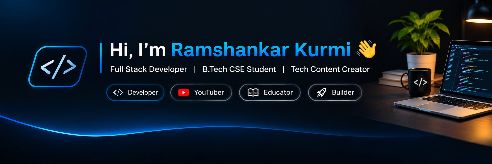

  

---
<!-- ======================================= -->
<!--       RAMSHANKAR PATEL - PROFILE         -->
<!-- ======================================= -->

<h3 align="center">
  Full Stack Developer | B.Tech CSE Student | Tech Enthusiast
</h3>

  

---

### 👨‍💻 About Me

-  B.Tech Computer Science Engineering Student.
-  Aspiring Full Stack Developer.
-  Currently improving my programming and development skills.
-  Interested in building practical and useful projects.
-  Believe in learning by building.
-  Goal: Become a skilled Software Developer.

---

###  Tech Stack & Skills

  

**Currently Exploring:**
- Programming Fundamentals
- Data Structures & Algorithms
- Frontend Development
- Backend Development
- Database Management

---

### Featured Projects

<!-- Add your best public projects here -->

| Project | Description | Tech Stack |

###  Featured Project

####  [RGPV Study Hub – Application](https://github.com/RGPV-Study-Hub/application)

A web application project focused on an academic learning platform.

**Tech Stack:**
- React
- JavaScript
- Vite
- Capacitor
- Supabase

🔗 [Explore Repository](https://github.com/RGPV-Study-Hub/application)

### GitHub Statistics

  
  

  

---

### 📈 Contribution Graph

  

---

### Connect With Me

  

---

<h3 align="center">
 "Consistency is the key to becoming a better developer."
</h3>

  Thanks for visiting my profile! 

